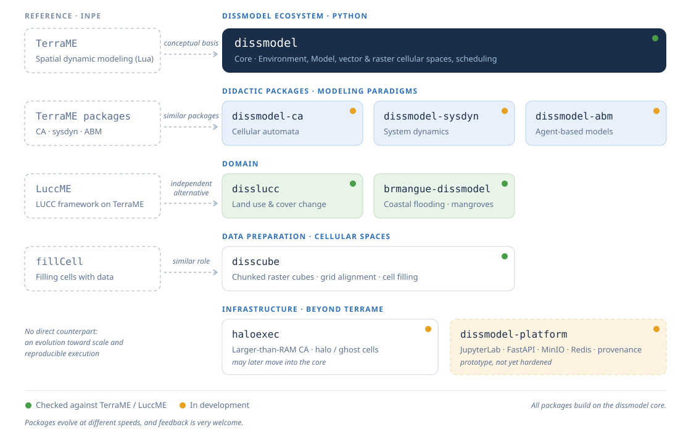

# DisSModel

**A Python framework for spatially explicit dynamic modeling, with
[TerraME](http://www.terrame.org/) as its conceptual basis.**

[](https://opensource.org/licenses/MIT)
[](https://www.python.org/)
[](https://pypi.org/project/dissmodel/)
[](https://pepy.tech/projects/dissmodel)
[](https://doi.org/10.5281/zenodo.23246106)
[](https://joss.theoj.org/papers/46522bc30d2dbec6b509d2dc487170ec)

DisSModel is the core of an ecosystem built at the
[LambdaGeo](https://github.com/LambdaGeo) group (UFMA, Brazil). It is an
independent, unofficial Python alternative to TerraME: the concepts are the
same (a clock, spatial substrates, models that run step by step), and the
stack is GeoPandas and NumPy instead of TerraLib and Lua. Models for cellular
automata, system dynamics, agents and land use and cover change (LUCC) live in
companion packages that build on this one.

Three ideas run through the design:

- **One clock, one lifecycle.** A model is a `Model` registered in an
  `Environment`. It runs `setup` once and then receives every tick through
  `pre_execute`, `execute` and `post_execute`.
- **Two substrates, one way of writing models.** The vector substrate
  (`GeoDataFrame`) fits irregular geometries and GIS joins; the raster
  substrate (`RasterBackend`, NumPy) is vectorised and fits large grids.
- **Reproducibility by design.** Science (the `Model`) is kept apart from
  infrastructure (the `ModelExecutor`: input and output, command line,
  provenance). Every run through an executor leaves an `ExperimentRecord` with
  SHA-256 checksums, the resolved TOML specification and the code version.

Status: version 0.6.6, on PyPI. A paper describing it is under review at the
[Journal of Open Source Software](https://joss.theoj.org/papers/46522bc30d2dbec6b509d2dc487170ec).

## Installation

```bash
pip install dissmodel                      # Python 3.10+
pip install "dissmodel[s3]"                # s3:// URIs (MinIO, AWS S3, ...)
pip install "dissmodel[xarray]"            # NetCDF and Zarr input and output
pip install "dissmodel[viz]"               # ipywidgets, for notebooks
```

## A model in a few lines

A forest fire on a 100 × 100 raster, with one ignition at the centre. The
model reads the state at the start of the step (`state_past`, the equivalent of
TerraME's `cell.past`) and writes the new one:

```python
import numpy as np
from dissmodel.core import Environment
from dissmodel.geo import SyncRasterModel, raster_grid

FOREST, BURNING, BURNED = 0, 1, 2


class ForestFire(SyncRasterModel):
    def setup(self, backend, prob_spread=0.4, seed=42):
        super().setup(backend)
        self.land_use_types = ["state"]       # bands kept as state_past
        self.prob_spread = prob_spread
        self.rng = np.random.default_rng(seed)

    def execute(self):                        # once per step: only maths, no I/O
        past = self.backend.get("state_past")
        burning_neighbours = self.backend.focal_sum_mask(past == BURNING)
        catch = (past == FOREST) & (
            self.rng.random(self.shape) < 1 - (1 - self.prob_spread) ** burning_neighbours
        )
        state = past.copy()
        state[catch] = BURNING
        state[past == BURNING] = BURNED
        self.backend.arrays["state"] = state


if __name__ == "__main__":
    grid = raster_grid(rows=100, cols=100, attrs={"state": FOREST})
    grid.arrays["state"][50, 50] = BURNING

    env = Environment(start_time=0, end_time=60)  # the Environment comes first
    ForestFire(backend=grid, prob_spread=0.4)     # models register themselves
    env.run()

    print(f"{(grid.get('state') == BURNED).mean():.0%} of the forest burned")
```

The same seed gives the same run. To see the model while it runs, add a
`RasterMap(backend=grid, band="state")` before `env.run()`. The vector version
of the same idea uses `SpatialModel` and `vector_grid`; see the
[documentation](https://dissmodel.github.io/dissmodel/) for both.

## From a script to a reproducible experiment

An executor wraps a model with everything that is not science: where the data
comes from, where the result goes and what is recorded. The model stays
untouched. Save the model above as `forest_fire_model.py` (the lines that build
the grid and call `env.run()` go under `if __name__ == "__main__":`), and wrap
it:

```python
# my_executor.py
from dissmodel.core import Environment
from dissmodel.executor import ExperimentRecord, ModelExecutor
from dissmodel.executor.cli import run_cli
from dissmodel.io import load_dataset, save_dataset

from forest_fire_model import ForestFire


class ForestFireExecutor(ModelExecutor):
    name = "forest_fire"
    output_suffix = ".tif"    # file type used when --output is a directory

    def load(self, record: ExperimentRecord):
        (backend, _meta), checksum = load_dataset(record.source.uri)
        record.source.checksum = checksum
        return backend

    def run(self, data, record: ExperimentRecord):
        env = Environment(end_time=record.parameters.get("end_time", 60))
        p = record.parameters
        ForestFire(backend=data, prob_spread=p.get("prob_spread", 0.4), seed=p.get("seed", 42))
        env.run()
        return data

    def save(self, result, record: ExperimentRecord) -> ExperimentRecord:
        uri = record.output_path or "output.tif"
        record.output_sha256 = save_dataset(result, uri)
        record.output_path = uri
        record.status = "completed"
        return record


if __name__ == "__main__":
    run_cli(ForestFireExecutor)
```

`forest.tif` is a raster with a `state` band (0 forest, 1 burning). The script
[`examples/hello_reproducible/make_input.py`](https://github.com/DisSModel/dissmodel/blob/main/examples/hello_reproducible/make_input.py)
creates one: run `python make_input.py` before the executor, or it stops
with `FileNotFoundError: 'forest.tif'`.

Parameters come from a TOML file and can be overridden on the command line:

```toml
# model.toml
[model.parameters]
end_time = 60
prob_spread = 0.4
seed = 42
```

```bash
python my_executor.py run --input forest.tif --output result.tif \
                          --toml model.toml --param prob_spread=0.5
python my_executor.py validate --input forest.tif   # check the data, do not run
python my_executor.py show --toml model.toml        # show the resolved parameters
```

The run adds a short experiment ID to the output name (`result_83bc068f.tif`;
`--preserve-output-name` turns that off) and writes next to it a
`result_83bc068f.record.json` and a `profiling_83bc068f.md` with the time of
each phase (validate, load, run, save). The ID (`83bc068f` here) is generated at
each run, so yours will be different, and so will the hashes and timings below.
The record has what is needed to repeat the run:

```json
{
  "experiment_id": "83bc068f...",
  "model_name": "forest_fire",
  "model_commit": "local-cli",
  "code_version": "0.6.6",
  "resolved_spec": { "model": { "parameters": { "end_time": 60, "prob_spread": 0.4, "seed": 42 } } },
  "source": { "uri": "forest.tif", "checksum": "e6079001..." },
  "parameters": { "end_time": 60, "prob_spread": 0.5, "seed": 42 },
  "output_path": "result_83bc068f.tif",
  "artifacts": { "output": "ec900273...", "profiling": "d044b85d..." },
  "metrics": { "time_run_sec": 0.014, "time_total_sec": 0.02 },
  "status": "completed"
}
```

`model_commit` is `local-cli` for a loose script; for an executor defined in an
installed package it records that package and its version (for example
`disslucc==0.5.0`).

### Check it and repeat it

From version 0.7 the record can be used, not only kept:

```bash
dissmodel verify result_83bc068f.record.json          # is the output the one in the record?
dissmodel reproduce result_83bc068f.record.json --module my_executor
dissmodel compare result_83bc068f.tif other.tif       # identical, values_identical, equivalent, differs
```

`reproduce` runs the model again from the record and compares the outputs;
`compare` says whether two outputs agree and exits with status 1 when they do
not. A step-by-step version, with the input file and the cases where the
verdict is `differs`, is in
[Getting started](https://dissmodel.github.io/dissmodel/getting_started/), and the
runnable files are in [`examples/hello_reproducible`](https://github.com/DisSModel/dissmodel/tree/main/examples/hello_reproducible).

### Cloud storage

Any `s3://bucket/key` URI works wherever DisSModel accepts a path: the
`--input` and `--output` options, `load_dataset` and `save_dataset`,
`load_geotiff` and `save_geotiff`. It talks to any S3-compatible endpoint (a
MinIO server of your own, AWS S3, ...) and needs nothing else:

```bash
pip install "dissmodel[s3]"
export MINIO_ENDPOINT=localhost:9000      # host:port, no scheme
export MINIO_ACCESS_KEY=your-access-key
export MINIO_SECRET_KEY=your-secret-key
export MINIO_SECURE=1                     # unset for plain HTTP, e.g. local dev
```

## The ecosystem

DisSModel is only the core. The models, the data preparation and the land use
components are separate packages, so each one can be installed, tested and
cited on its own. The map shows how they relate to their counterparts in
INPE's TerraME ecosystem.

<p align="center">
  
</p>

| Package | What it is | TerraME counterpart | Install |
| --- | --- | --- | --- |
| [`disscube`](https://github.com/DisSModel/disscube) | DisSCube: declarative spatial data cubes. Sources, grid and derived variables in TOML; hands the cube to DisSModel models | `fillCell` | `pip install "disscube[dissmodel]"` |
| [`disslucc`](https://github.com/DisSModel/disslucc) | DisSLUCC: demand, potential and allocation components for LUCC, continuous (CLUE-like) and discrete (CLUE-S-like), raster only | LuccME | `pip install disslucc` |
| [`dissmodel-ca`](https://github.com/DisSModel/dissmodel-ca) | Cellular automata: Game of Life, forest fire, growth, ... | `ca` | `pip install "git+https://github.com/DisSModel/dissmodel-ca.git"` |
| [`dissmodel-sysdyn`](https://github.com/DisSModel/dissmodel-sysdyn) | System dynamics: SIR, predator-prey, Lorenz, ... | `sysdyn` | `pip install "git+https://github.com/DisSModel/dissmodel-sysdyn.git"` |
| [`dissmodel-abm`](https://github.com/DisSModel/dissmodel-abm) | Agent-based modeling in the style of TerraME (alpha) | `logo` | `pip install "git+https://github.com/DisSModel/dissmodel-abm.git"` |
| [`brmangue-dissmodel`](https://github.com/DisSModel/brmangue-dissmodel) | BR-MANGUE: coastal flooding and mangrove succession, raster and vector | BR-MANGUE | `pip install "git+https://github.com/DisSModel/brmangue-dissmodel.git"` |

A typical workflow uses three of them: DisSCube builds the grid from open data,
DisSModel runs the model, and DisSLUCC supplies the land use components.

### How the packages are checked

The packages are not taken on trust: they are compared with TerraME and LuccME
themselves. The reference outputs are kept in repositories of their own, so
anyone can repeat the comparison:

- [`terrame-goldens`](https://github.com/LambdaGeo/terrame-goldens): runs of the
  TerraME `ca`, `sysdyn` and `logo` packages, for many seeds.
- [`luccme-goldens`](https://github.com/LambdaGeo/luccme-goldens): runs of
  TerraME and LuccME, produced with
  [`terrame-docker`](https://github.com/LambdaGeo/terrame-docker).
- [`disscube-benchmark`](https://github.com/LambdaGeo/disscube-benchmark) and
  [`disslucc-benchmark`](https://github.com/LambdaGeo/disslucc-benchmark):
  DisSCube and DisSLUCC against those reference outputs.

The [repository map](https://dissmodel.github.io/repository-map.html) shows how
all of these connect, from the TerraME reference to the open-data workflow.

### DisSModel Platform

The DisSModel Platform (FastAPI, Redis, Docker, MinIO) is a prototype for
running executors through a job queue. It is a separate project, it is not
production-ready, and nothing in this README depends on it: everything here
works locally with `pip install dissmodel`.

## Documentation

- [User guide](https://dissmodel.github.io/dissmodel/)
- [API reference](https://dissmodel.github.io/dissmodel/api/core/)
- [Examples](https://dissmodel.github.io/dissmodel/examples/)
- [Geospatial Modeling with Python](https://lambdageo.github.io/geospatial-modeling-python/), an open book that introduces the ecosystem step by step
- [`CHANGELOG.md`](CHANGELOG.md)

## Where it comes from

DisSModel is the current chapter of a longer line of work at LambdaGeo on
reproducible, interoperable spatial modeling: Terra Translator (2002), TerraHS
(2005), then TerraME and LuccME at INPE (2007 to 2010), whose ideas DisSModel
takes up in Python. More at [lambdageo.github.io](https://lambdageo.github.io/).

## Contributing

Contributions are welcome. Please read the [contributing guidelines](CONTRIBUTING.md)
and the [code of conduct](CODE_OF_CONDUCT.md). Bugs and feature requests go to
[GitHub Issues](https://github.com/DisSModel/dissmodel/issues).

```bash
git clone https://github.com/DisSModel/dissmodel
cd dissmodel
pip install -e ".[dev]"
pytest
```

## Citation

If you use DisSModel, please cite it with the metadata in
[`CITATION.cff`](CITATION.cff) (GitHub shows it under "Cite this repository").
Each release has its own DOI on Zenodo; the badge above points to the latest.

## License

MIT; see [`LICENSE`](LICENSE).